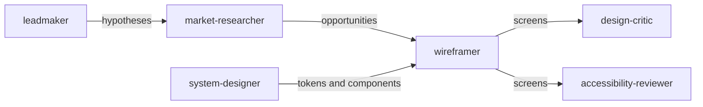

# Design Agents for Claude Code

Seven [Claude Code](https://claude.com/claude-code) subagents for day-to-day Product Design work: wireframing, design systems, market research, retention research, accessibility review, design critique and UX research.

Each agent is a text file with instructions. Claude Code reads the file and hands the task to the right agent when you ask.

## The agents

| Agent | What it is for | What it delivers |
|---|---|---|
| `wireframer` | Turning ideas into low- and high-fidelity wireframes, user flows and clickable prototypes | HTML files, a Mermaid flow and a note with design decisions and hypotheses to test |
| `system-designer` | Auditing, extending or creating a design system | Tokens in JSON and CSS variables, component documentation and a changelog |
| `market-researcher` | Mapping a product's usability friction and benchmarking how competitors solve it | A report with friction map, benchmark table, prioritized opportunities and linked sources |
| `leadmaker` | Turning interview transcripts into leads for engaging and retaining customers | A qualitative report and a list of leads, each with evidence, hypothesis and how to validate |
| `accessibility-reviewer` | Reviewing screens, flows, Figma links, images or front-end code against WCAG 2.2 level AA | A table with the problem, WCAG criterion, severity and suggested fix |
| `design-critic` | Critiquing a screen or flow with Nielsen's 10 heuristics, with a focus on complex B2B products | A list of problems with heuristic, impact and suggestion, plus the 3 improvements with the highest impact and lowest effort |
| `ux-researcher` | Planning research, writing interview guides, synthesizing interviews and analyzing quantitative data | A research plan, an interview guide, a synthesis by theme with real quotes, or a cautious reading of the numbers |

## How they work together

An agent cannot call another agent. Each one ends its reply with a "Next step" that says which agent should receive the result, and you pass it on.



## Principles

- **No invention.** No made-up data, statistics, quotes, competitors or features. The accessibility reviewer only cites criteria that exist in WCAG 2.2.
- **Evidence kept apart from hypothesis.** What came from the material and what is interpretation are marked.
- **Sources linked.** Every claim the market researcher makes about a competitor has a link.
- **Questions before assumptions.** `wireframer`, `system-designer`, `market-researcher` and `leadmaker` ask for the niche, the audience and the platform when you have not stated them, with at most 3 questions.
- **Stated limits.** Each agent says what it could not verify with the material it received.
- **Read-only reviews.** The accessibility and critique agents do not change files.

## How to use each agent, explained for a 10-year-old

Describe the task and Claude Code picks the agent. To be sure, mention the agent by name.

### wireframer

Imagine you want to build a treehouse. Before you pick up the hammer, you draw on paper where the door, the ladder and the window go. This agent makes that drawing, but for app screens. It sketches in gray first, just to see whether everything is in the right place. If you like it, it colors it in and makes the buttons work so you can click through the screens.

```
Use the wireframer agent to draw the log-a-workout screen. Niche: fitness. Audience: people who train at the gym and use the app with one hand. Platform: mobile. Fidelity: low.
```

### system-designer

Imagine a box of building blocks. For everything to fit, the pieces need the same studs and a matching set of colors. This agent organizes the box: it says which colors exist, which piece sizes are allowed, and writes the manual for each piece. If the box already exists, it looks for missing pieces, duplicate pieces and pieces that do not fit.

```
Use the system-designer agent to audit the tokens in src/styles/tokens.css. Niche: fintech. Audience: small business owners. Platform: web.
```

### market-researcher

Imagine you have a lemonade stand and the line moves slowly. This agent is the detective who finds out where the line gets stuck and then peeks at the other stands on the street to see how they solve the same problem. Everything it tells you comes with the address of where it saw it. When it only suspects something, it tells you it is a guess.

```
Use the market-researcher agent to map the onboarding friction of [product name], site [address], and see how competitors solve it. Niche: B2B SaaS. Audience: integration analysts. Platform: web.
```

### leadmaker

Imagine several friends stopped coming to your club. You talked to each one and recorded the conversations. This agent listens to everything and writes down the clues: what made them like the club, what upset them and what was already hinting they would leave. Each clue comes with the exact sentence your friend said, and names are swapped for secret nicknames. These are not clues for selling anything: they are clues for making people want to stay.

```
Use the leadmaker agent to analyze the transcripts in research/interviews, with the interview guide in research/guide.md. Niche: fitness. Audience: subscribers who cancelled in the last 3 months. Platform: mobile.
```

### accessibility-reviewer

Imagine a playground. Some kids use wheelchairs, some cannot see well, some cannot use a mouse. This agent walks around checking that everyone can get in and play: is the sign readable, is the button big enough, can you get around using only the keyboard. Then it hands you a list of what to fix first.

```
Use the accessibility-reviewer agent to review the login screen in src/pages/Login.tsx
```

### design-critic

Imagine you made a board game and want to know whether new players will get lost. This agent is the honest friend who plays it and tells you exactly where the rules confuse people, without saying "nice job" just to be polite. It ends with the three easiest fixes that help the most.

```
Use the design-critic agent to critique the screen in screens/dashboard.png
```

### ux-researcher

Imagine you want to know what your classmates really think about the school cafeteria. This agent helps you write questions that do not put words in their mouths, then sorts the answers into piles. It never pretends someone said something they did not say.

```
Use the ux-researcher agent to synthesize the interviews in the research/interviews folder
```

## Good to know

- You can also call an agent with `@`: type `@agent-` and pick the agent from the list.
- To work from an image, save the file in a folder and give its path.
- The agents reply in the language you write in.
- `wireframer`, `system-designer`, `market-researcher` and `leadmaker` save their results in an `outputs/` folder inside your project, one folder per agent.

## How to install

1. Download this repository.
2. Copy the files from the `.claude/agents/` folder to one of these places:
   - **A single project:** the `.claude/agents/` folder inside the project.
   - **All your projects:** the `.claude/agents/` folder of your user. On Windows, `C:\Users\YOUR_USER\.claude\agents\`. On Mac and Linux, `~/.claude/agents/`.
3. Close and reopen Claude Code.

## Structure

```
.claude/
  agents/
    wireframer.md
    system-designer.md
    market-researcher.md
    leadmaker.md
    accessibility-reviewer.md
    design-critic.md
    ux-researcher.md
README.md
```

## How to adapt

Open the agent file in any text editor. The header, between the `---` lines, sets the name, when the agent is used and which tools it has. The text below it is the instructions. Change what you want and save.

File format: [Claude Code subagents documentation](https://code.claude.com/docs/en/sub-agents).

## License

[MIT](LICENSE). You can copy, change and share these agents, as long as you keep the copyright notice.
